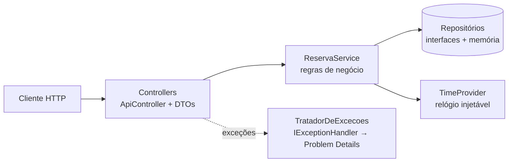

# ASP.NET Core Web API — Reserva de Laboratórios

[](https://github.com/edufurlanetti/dotnet-aspnet-core-web-api/actions/workflows/ci.yml)

API REST em **ASP.NET Core 8** para **reserva de laboratórios e salas** de uma faculdade. Ela impede conflitos de horário, turmas acima da capacidade e reservas fora do horário de funcionamento. O projeto mostra uma Web API organizada em camadas, com injeção de dependência, tratamento global de erros e testes de unidade e de integração.

> Material da disciplina de Desenvolvimento Web com .NET (ADS) — Prof. Eduardo Furlanetti.

## Arquitetura



## Regras de negócio

- Não pode haver **sobreposição** com outra reserva ativa do mesmo laboratório.
- A turma não pode exceder a **capacidade** do laboratório.
- O horário deve ficar entre **07h e 23h**, no mesmo dia, com no máximo **4 horas**, e não pode cair em **domingo**.
- Não se reserva **no passado** nem se cancela uma reserva que **já começou**.

## Endpoints

| Método | Rota | Descrição | Sucesso |
|---|---|---|---|
| `GET` | `/api/laboratorios?capacidadeMinima=` | Lista laboratórios | 200 |
| `GET` | `/api/laboratorios/{id}` | Detalhes do laboratório | 200 |
| `GET` | `/api/laboratorios/{id}/ocupacao?data=AAAA-MM-DD` | Horas reservadas e taxa de ocupação no dia | 200 |
| `GET` | `/api/reservas?laboratorioId=&data=` | Lista reservas com filtros | 200 |
| `GET` | `/api/reservas/{id}` | Busca reserva | 200 |
| `POST` | `/api/reservas` | Cria reserva | 201 + `Location` |
| `DELETE` | `/api/reservas/{id}` | Cancela reserva | 204 |

Os erros seguem a **RFC 9457 (Problem Details)**: `400` para validação, `404` para recurso inexistente e `422` para regra de negócio.

```json
{
  "title": "Regra de negócio violada",
  "status": 422,
  "detail": "Conflito com a reserva 1 (Banco de Dados I), das 19:00 às 22:30"
}
```

## Como executar

Requisito: [.NET SDK 8](https://dotnet.microsoft.com/download).

```bash
dotnet run --project src/ReservaLabs.Api
```

Abra a URL exibida no terminal: a raiz redireciona para o **Swagger UI**. Também é possível usar o arquivo `src/ReservaLabs.Api/ReservaLabs.Api.http`, no Visual Studio ou no VS Code com a extensão REST Client.

### Testes

```bash
dotnet test
```

- `ReservaServiceTests`: testes de unidade das regras, incluindo `[Theory]` com vários cenários de sobreposição.
- `ApiIntegracaoTests`: testes de integração com `WebApplicationFactory`, que sobem a API em memória e fazem requisições HTTP reais.
- `RelogioFixo`: substitui o `TimeProvider` para que os testes não dependam da data de execução.

## Conceitos praticados

Controllers com `[ApiController]` · rotas com restrição (`{id:int}`) · DTOs `record` com DataAnnotations · injeção de dependência e tempos de vida (Singleton × Scoped) · construtores primários (C# 12) · inversão de dependência com interfaces · `IExceptionHandler` e Problem Details · `CreatedAtAction` · `TimeProvider` (.NET 8) · coleções thread-safe e `lock` · xUnit (`Fact`/`Theory`) · `WebApplicationFactory` · GitHub Actions.

## Próximos passos sugeridos

1. Trocar os repositórios em memória por **Entity Framework Core** com SQL Server (veja o repositório [`dotnet-aspnet-core-mvc`](https://github.com/edufurlanetti/dotnet-aspnet-core-mvc)).
2. Adicionar autenticação **JWT**, permitindo que só o responsável cancele a própria reserva.
3. Criar o endpoint `GET /api/laboratorios/disponiveis?inicio=&fim=&alunos=`.

## Licença

[MIT](LICENSE)
